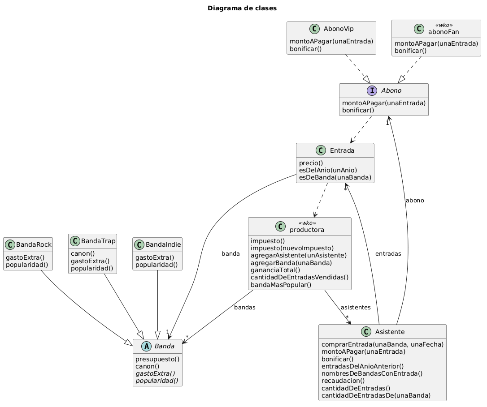

# PDEP Entertainment

## Decisiones importantes

### Impuesto inicial de 200

El enunciado dice que la productora fija el impuesto pero no da un valor de partida. Como hay que poner algo para que el sistema funcione, se eligió 200 de forma arbitraria. Se puede cambiar cuando se quiera con impuesto(nuevoImpuesto).

### Validación previa a la compra

Al ejecutar comprarEntrada, lo primero que verifica el sistema es que el saldo sea positivo, y si no lo es, lanza un error de inmediato. Así se evita que la compra quede a medias. En este punto se siguió el enunciado al pie de la letra: No se exige que el saldo alcance para cubrir toda la entrada. Solo se valida que sea positivo al momento de la compra, permitiendo que después el saldo quede en negativo.

### El abono como objeto separado

En lugar de crear distintos tipos de asistentes (fan y vip), se modeló el abono como un objeto independiente. Gracias a esto, el asistente simplemente tiene un abono y le puede consultar cuánto debe pagar. De esta manera, si un fan pasa a ser vip, solo se le actualiza el abono manteniendo intacto su historial de entradas.

### La productora conoce a todos

Para calcular la ganancia total del evento es necesario restar el presupuesto de todas las bandas. Por eso la productora necesita conocer y tener registro tanto de los asistentes como de las bandas (mediante agregarAsistente y agregarBanda).

## Conceptos aplicados

### 1. Herencia y clases abstractas

Como las tres bandas comparten características (el nombre, el canon base y la forma de calcular el presupuesto), todo eso se agrupó en la clase abstracta Banda. Las clases BandaRock, BandaTrap y BandaIndie heredan de ella sus métodos y atributos y solo definen sus particularidades. La banda de trap, por ejemplo, redefine el canon porque es la única que lo calcula distinto. Se usó herencia porque una banda no cambia de género mientras corre el programa, y asi no se repite logica.

### 2. Polimorfismo

abonoFan y AbonoVip entienden los mismos mensajes, entonces el asistente puede calcular el monto a pagar sin importar qué abono tenga y sin necesidad de usar condicionales. Lo mismo aplica para las bandas.

### 3. Delegación y encapsulamiento

Cada objeto se encargue de lo suyo. La entrada sabe si es de un año o de una banda, el asistente sabe cuánto recaudó, y la productora solo recolecta esos totales. El asistente también delega la acción de bonificar en su abono.

### 4. WKO

Como hay una sola productora y el impuesto es el mismo para todas las entradas, se implementó como un objeto único. Cada entrada le consulta el impuesto al calcular su precio, y si la productora lo cambia, todas lo toman automáticamente. abonoFan también es un WKO porque no tiene estado propio.

### 5. Colecciones

En vez de recorrer las colecciones a mano, se usaron funciones de orden superior. Se aplicó filter para las entradas del año anterior, map para obtener los nombres de las bandas, asSet para evitar duplicados, etc.

## Diagrama de clases

